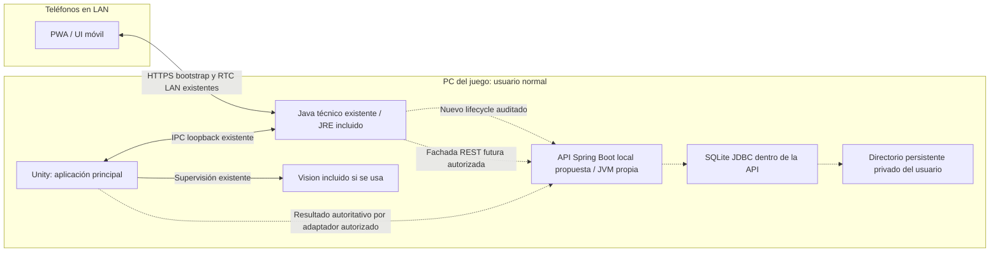
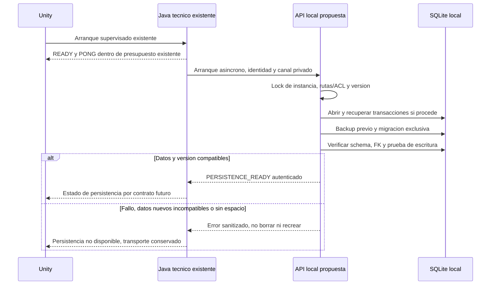
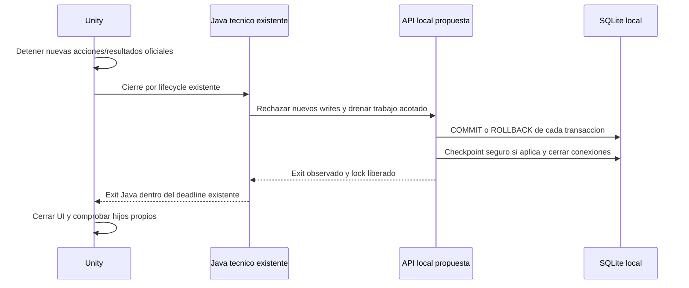

# Despliegue, arranque y cierre

Última revisión: 2026-10-16. Alcance: evaluación y diseño; ninguna funcionalidad implementada. Fuentes primarias y revisiones locales en [SOURCES.md](SOURCES.md).

## Despliegue objetivo con SQLite

Flechas continuas: relación existente auditada; discontinuas: integración propuesta. Todas las cajas de API/SQLite son diseño, no artefactos disponibles. La instalación única incluye los runtimes necesarios; el jugador no instala Java, Spring Boot, Docker ni herramientas SQL.

La arista Unity→API expresa responsabilidad funcional, no un endpoint ya existente ni credencial resuelta. Puerto API sólo loopback; SQLite no crea puerto BD. La fachada HTTP del teléfono termina en Java y debe autorizar sólo operaciones de dominio aprobadas, sin compartir credenciales de operador. El tráfico táctil/sensor sigue por RTC/IPC y no entra al SQL por lectura.

## Arranque propuesto

Nueva instalación: crear fichero vacío únicamente cuando no existen datos ni estado previo. Datos presentes y apertura fallida no equivalen a primer arranque. El chequeo de escritura usa una transacción de prueba controlada/rollback, no inserta un jugador fantasma. El lock de aplicación no sustituye locks SQLite.

## Cierre propuesto

Checkpoint incompleto no autoriza borrar WAL. Si cierre excede presupuesto, registrar cierre forzado y conservar archivos recuperables; siguiente arranque valida estado. Forzado no se etiqueta cierre limpio. Kill abrupto en cualquier punto requiere los casos de [aceptación](ACCEPTANCE_MATRIX.md); no hay PASS de estas secuencias. [Auditoría del supervisor](adr/SUPERVISOR_AUDIT.md).
