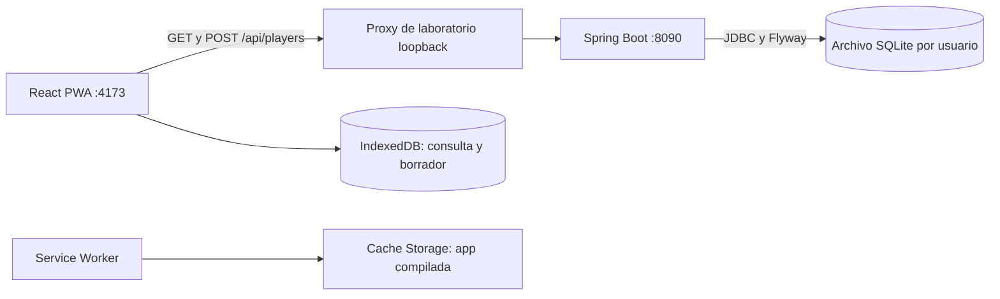

# Laboratorio de pruebas PWA — Gorilla Escape: Gorilimpiadas

Fecha: 16 de octubre de 2026 (America/Chihuahua; timestamps técnicos UTC del 17 de octubre). Modalidad: equipo. Datos exclusivamente ficticios.

**Estado:** integración funcional y evidencias ejecutadas; pendientes las tres capturas literales de DevTools antes de considerar completa la entrega visual de la rúbrica. Los archivos JSON obtenidos del protocolo de depuración son registros auténticos, no capturas de pestañas DevTools.

## Repositorios y alcance

- Proyecto integrador: [Gorilla Escape](https://github.com/Josue1855/Gorilla-Escape).
- Backend y dossier de evidencias: [rama de laboratorio](https://github.com/Josue1855/Gorilla-Escape-Backend/tree/feature/players-sqlite-increment/docs/laboratorio), [PR #14](https://github.com/Josue1855/Gorilla-Escape-Backend/pull/14) hacia develop, sin merge automático.
- Frontend del laboratorio: [fork de trabajo](https://github.com/Josue1855/Dise-o_pwa/tree/codex/pwa-database-lab). El repositorio de Hiram [Quintana-117/Dise-o_pwa](https://github.com/Quintana-117/Dise-o_pwa) sólo permite lectura a esta cuenta y sólo tenía main. En el fork se creó develop sobre ese baseline y una rama codex; no se cambiaron los main ni el upstream.

Pantalla dedicada /lab.html: integración de negocio real, separada de la pantalla histórica de mando. El mando original conserva su demostración; no se certifica gameplay ni integración WebRTC/Unity. El laboratorio no consume JSONPlaceholder ni depende de recursos remotos para consultar jugadores.

## Arquitectura ejecutada

El proxy es una herramienta de desarrollo Node, no un nuevo supervisor del videojuego ni un instalador final. API y BD permanecen en loopback. No se exponen puertos SQL ni se altera el transporte Unity ↔ Java ↔ PWA.

## Reproducir

Requiere JDK21, Node24/npm y Python3 sólo para inspección SQL. La primera preparación necesita red; el JAR compilado y la PWA instalada en caché no descargan dependencias al ejecutarse.

1. Checkout de la rama backend indicada; ejecutar `./mvnw verify` (Windows: `mvnw.cmd verify`).
2. Iniciar `java -jar target/backend-0.1.0-SNAPSHOT.jar --gorilla.storage.directory=/ruta/absoluta/laboratorio-nuevo`. No usar una BD de usuarios reales.
3. Checkout de la rama frontend indicada. Ejecutar `npm ci`, `npm test`, `npm run build`, `npm run lab`.
4. Abrir http://127.0.0.1:4173/lab.html. Esperar Service Worker activo y primera consulta completada.
5. Aplicar [seed.sql](../../scripts/sql/seed.sql) sobre esa BD; inspeccionar con [query.sql](../../scripts/sql/query.sql). Pulsar Actualizar listado. No es necesario instalar un servidor SQL.
6. Registrar nombre ficticio. Ver 201, UUID y fila SQLite coincidente. Actualizar y verificar GET200 con la misma identidad.
7. En DevTools → Network, seleccionar Offline y recargar /lab.html. Deben aparecer el shell y la última consulta local marcada como tal. Escribir borrador, pulsar Registrar y comprobar que no se presenta como guardado en el servidor. Recargar: el borrador permanece.
8. Restablecer Online: no se envía ningún POST automáticamente. Actualizar → GET. Pulsar Registrar explícitamente → 201; actualizar → listado confirmado.
9. Limpiar sólo las semillas y los UUID confirmados de esta ejecución con [cleanup.sql](../../scripts/sql/cleanup.sql), ligando `:created_player_id`. Con dos POST, ejecutar una vez por UUID. Nunca borrar globalmente una base ajena.

La captura automatizada usó Chrome real de escritorio y emulación de red del protocolo DevTools. No se desconectó físicamente el Internet/LAN, ni se probó un teléfono o PC limpia. Offline inicial sin visita previa no está soportado: no existe shell/consulta previamente guardada. La consulta muestra primera página (máximo 100), no el universo de jugadores.

## Resultados y evidencias

| Caso | Resultado observado | Archivo |
|---|---|---|
| SQL inicial | Dos filas semilla; integridad ok | [sql-antes.json](evidencias/sql-antes.json) |
| POST desde React | 201, UUID bf6eee24-88e7-437f-abd1-9ed1fa2e27f8 | [02-post-confirmado.jpg](evidencias/02-post-confirmado.jpg) |
| SQL después | Tres filas; borrador offline todavía ausente | [sql-despues-post-y-offline.json](evidencias/sql-despues-post-y-offline.json) |
| GET renderizado | 200 y mismo UUID/valores | [03-get-renderizado.jpg](evidencias/03-get-renderizado.jpg) |
| Red real | Headers, timings, bytes recibidos y códigos GET/POST | [network-online.json](evidencias/network-online.json) |
| SW/Cache/IndexedDB | Worker activated/controlador activo; nueve recursos compilados; snapshot3 y borrador | [application-offline.json](evidencias/application-offline.json) |
| Offline/recarga | Listado previo y borrador conservados; sin falso éxito SQLite | [04](evidencias/04-offline-borrador.jpg), [05](evidencias/05-offline-recarga.jpg) |
| Reconexión | Sin reenvío automático; GET seguido de POST manual201 | [06](evidencias/06-reconexion-borrador.jpg), [07](evidencias/07-borrador-enviado-online.jpg), [red](evidencias/network-reconexion-envio-manual.json) |
| Resultado final SQL | Cuatro filas, una por cada envío confirmado; integridad ok | [sql-final.json](evidencias/sql-final.json) |
| Backend inaccesible simulado | Ruta API bloqueada con red disponible; envío incierto protegido incluso tras recargar | [08](evidencias/08-envio-incierto-protegido.jpg) |
| Validación UI y backend | Nombre inválido bloqueado en UI; POST directo inválido400 sin escritura | [09](evidencias/09-validacion-ui.jpg), [400](evidencias/post-invalido-400.json) |
| Logs Spring Boot | GET/POST/status/requestId, duración, heap JVM y filas afectadas por INSERT | [backend-application.log](evidencias/backend-application.log) |
| Console | Registro real de renderizado, HTTP y errores offline esperados | [console.json](evidencias/console.json) |
| Build final | Vite6.4.4; shell final verificado offline/online, cuatro filas | [10](evidencias/10-compilacion-final-offline.jpg), [11](evidencias/11-compilacion-final-online.jpg), [SW final](evidencias/application-final-build.json) |
| Pruebas | Siete tests del cliente PASS y build PASS; auditoría npm sin vulnerabilidades reportadas | [tests](evidencias/frontend-tests.txt), [build](evidencias/frontend-build.txt), [audit](evidencias/frontend-audit.json) |

Las capturas 01–09 corresponden al build inicial Vite5.4.21; después se actualizaron Vite6.4.4 y plugin-react4.7.0 para resolver avisos reales de auditoría. El código funcional no cambió y 10–11 prueban el nuevo shell. Se conserva la trazabilidad de ambas cachés, sin presentar la antigua como build final. Las 17 pruebas del backend y CI Linux/Windows previas constan en [validación de jugadores](../VALIDATION_PLAYERS.md); el PR ejecuta nuevamente sus checks al publicar estas evidencias.

Server-Timing y durationMs son procesamiento backend, no latencia de juego; eventos Network incluyen el tiempo del cliente y bytes de transferencia. heap JVM no es RSS ni asignación por solicitud. Las consultas Python sobre SQLite no son respuestas HTTP: se comparan explícitamente por UUID. Un log de INSERT no sustituye la comprobación posterior del COMMIT/SELECT.

## Política offline y fallos

Cache Storage sólo contiene app shell del mismo origen; API y POST quedan fuera del Service Worker. IndexedDB conserva la última consulta y un borrador. La reconexión sólo avisa; no ejecuta Background Sync ni reenvía POST. Un error de red/5xx deja el intento incierto marcado antes de transmitir y bloqueado tras recargar. El usuario debe reconciliar con listado/logs antes de habilitar otro envío. No se promete deduplicación ni idempotencia del backend. Puede haber nombres repetidos válidos; no reconciliar únicamente por nombre cuando la respuesta se perdió.

Cargar la aplicación sin WAN pero con LAN activa es distinto de no alcanzar el backend. Aquí se emuló ausencia de red del navegador y fallo selectivo de API; la prueba LAN/WAN física sigue pendiente y no se afirma como ejecutada.

## Tres capturas pendientes de DevTools

La política de navegación de la herramienta bloqueó chrome://inspect; no se eludió esa restricción ni se fabricó una interfaz DevTools. Los registros de CDP adjuntos son reales, pero **no sustituyen las capturas literales** solicitadas por la rúbrica:

1. **Network:** con la PWA abierta, F12 → Network → Fetch/XHR. Actualizar y registrar un nombre ficticio. Capturar lista, Timing, tamaño y Headers de /api/players. Ocultar cookies/tokens si los hubiera.
2. **Application:** Service Workers → sw.js activated, Cache Storage → gorilla-lab-shell-…, IndexedDB → gorilla-players-lab-v1/state. Capturar snapshot/draft y estado offline/online.
3. **Console:** mostrar event=players_http y event=players_rendered después de GET/render. Los errores net::ERR_INTERNET_DISCONNECTED durante el caso Offline son esperados; capturar también recuperación sin errores inesperados.

Guardar las imágenes como `12-devtools-network.png`, `13-devtools-application.png`, `14-devtools-console.png` en evidencias, revisar privacidad y añadirlas mediante rama/PR. Hasta entonces, la parte visual de DevTools está pendiente. No se envió nada a la plataforma universitaria.

Referencias técnicas: [Vite: assets públicos](https://vite.dev/guide/assets.html), [Chrome: depuración PWA](https://developer.chrome.com/docs/devtools/progressive-web-apps).
