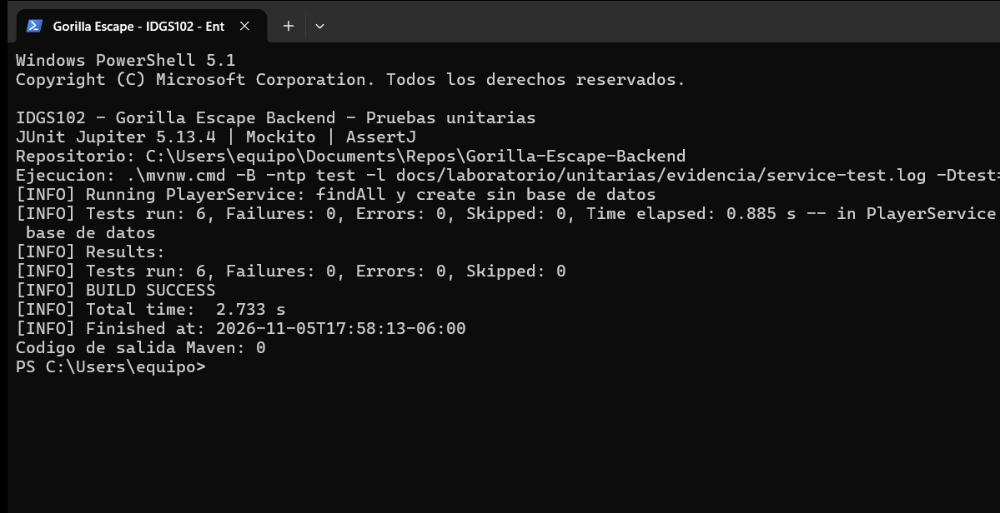

# Práctica IDGS102: pruebas unitarias de findAll y create

Asignatura: Aplicaciones Web Progresivas / Desarrollo Backend. Unidad: Pruebas de Software y Calidad de Componentes.

## Aplicación de la guía al proyecto

La entidad de este proyecto es `Player` (jugador), equivalente al `Producto` del ejemplo.
`PlayerService.findAll(limit, offset)` obtiene una página de jugadores y `create(displayName)` crea un jugador.
El contrato HTTP conserva GET/POST `/api/players` y su paginación. El método de listado del servicio antes se llamaba `list`.
El repositorio usa `list` e `insert`; `insert` devuelve `void`, por eso la prueba de creación verifica el argumento persistido con `ArgumentCaptor`, sin simular un `save` inexistente.

Se mantiene Spring Boot **4.1.1** y JDK **21** del backend actual, con autorización del alumno para esta adaptación de la guía (que propone Boot 3.x).
`spring-boot-starter-test` ya estaba declarado con alcance `test`.
El POM fija `junit-jupiter.version=5.13.4` para ejecutar **JUnit 5**, en lugar de JUnit 6 del BOM de Boot 4.
Mockito y AssertJ provienen del starter de pruebas.

## Entregables

1. [Servicio: implementación de findAll y create](../../../src/main/java/com/gorillaescape/backend/players/application/PlayerService.java).
2. [Puerto del repositorio](../../../src/main/java/com/gorillaescape/backend/players/domain/PlayerRepository.java) y [repositorio JDBC](../../../src/main/java/com/gorillaescape/backend/players/infrastructure/JdbcPlayerRepository.java).
3. [PlayerServiceTest](../../../src/test/java/com/gorillaescape/backend/players/PlayerServiceTest.java), bajo `src/test/java`.
4. [Captura real de Windows Terminal](evidencia/terminal-junit5.png), [log de las seis unidades](evidencia/service-test.log) y [log de la suite completa](evidencia/mvn-test.log).

## Resultado registrado

Ejecución local del 5 de noviembre de 2026, Windows y Microsoft OpenJDK 21.0.13:

- Práctica `PlayerServiceTest`: **6 pruebas, 0 fallos, 0 errores, 0 omitidas**.
- Suite completa `test`: **21 pruebas, 0 fallos, 0 errores, 0 omitidas** (6 del servicio, 2 de validación y 13 de integración HTTP/SQLite).
- Ambas ejecuciones con **BUILD SUCCESS** y código de salida Maven **0**, usando JUnit Jupiter **5.13.4**.



La captura muestra un resumen literal del log impreso por el script; el log completo también se conserva.

## Diseño de las pruebas

`@ExtendWith(MockitoExtension.class)` inicializa Mockito; `@Mock` sustituye el repositorio y `@InjectMocks` construye el servicio.
`@BeforeEach` prepara un jugador conocido y `@DisplayName` describe cada escenario.
Los casos siguen Given / When / Then. No se inicia Spring ni se abre una base de datos en `PlayerServiceTest`.

| Método | Escenario y verificación |
| --- | --- |
| findAll | Dos jugadores: contenido completo y orden, parámetros de paginación e invocación única al repositorio. |
| findAll | Sin jugadores: lista vacía, no nula. |
| findAll | Fallo de almacenamiento: propaga la excepción, sin aparentar una página vacía. |
| create | Conserva el nombre y genera UUID/fecha; devuelve el mismo objeto que se envía a insertar una sola vez. |
| create | Dos creaciones con el mismo nombre reciben identidades independientes. |
| create | Fallo de inserción: propaga la excepción, sin devolver éxito. |

Las validaciones del nombre pertenecen a `CreatePlayer` y ya tienen su propia clase de pruebas.
Las pruebas HTTP/SQLite son de integración y se distinguen de estas seis unidades aisladas.

## Reproducir

Desde la raíz del backend, con JDK 21:

```powershell
# Todas las pruebas (equivalente a mvn test usando Maven Wrapper):
.\mvnw.cmd -B -ntp test

# Sólo las seis pruebas de esta práctica:
.\mvnw.cmd -B -ntp "-Dtest=PlayerServiceTest" test

# Guardar log y reportes como evidencia:
powershell -NoProfile -File .\tools\test-unit-lab.ps1
powershell -NoProfile -File .\tools\test-unit-lab.ps1 -ServiceOnly
```

En Linux/macOS: `./mvnw -B -ntp test`. Si Maven está instalado: `mvn test`.
No se necesita arrancar el servidor ni conectar la PWA.
El primer uso del Wrapper puede descargar Maven y dependencias.

Los logs completos de la suite incluyen excepciones provocadas deliberadamente por pruebas de integración (base corrupta, directorio ocupado y migración incompatible). El resultado de Surefire y el código de salida determinan si pasó la ejecución.
Mockito puede emitir un aviso de carga dinámica de agente en JDK 21; no significa que una prueba haya fallado.
